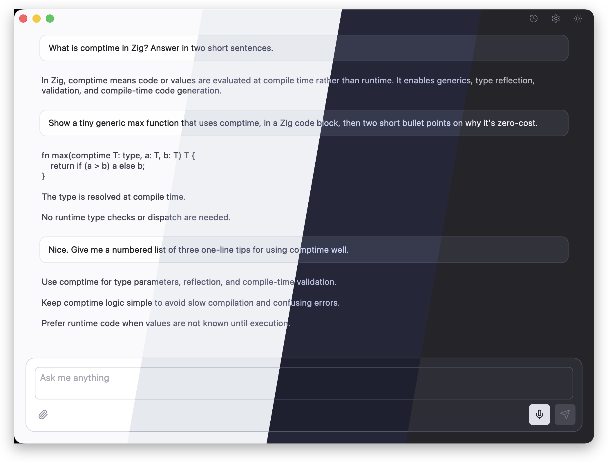

# Gooey

A GPU-accelerated UI library for Zig. It targets macOS (Metal), Linux (Wayland with
Vulkan or a CPU renderer, or the kernel framebuffer), Windows (Win32 with Vulkan or
Direct3D 11), and the browser (WASM with WebGPU).

Join the [Gooey discord](https://discord.gg/bmzAZnZJyw)


[][ci]

[ci]: https://github.com/duanebester/gooey/actions/workflows/ci.yml

Example app built with Gooey: [**chat-zig**](https://github.com/duanebester/chat-zig),
a Claude and GPT chat client, shown in its Light, Latte, Macchiato,
and Dark themes.

<a href="https://github.com/duanebester/chat-zig">
  
</a>

## Features

- **Small core.** An app is a state struct, a render function, and handlers. `gooey.App`,
  `gooey.Cx`, and `gooey.ui` cover most of it.
- **Static memory.** Each app declares a resource budget at compile time. Gooey reserves
  everything before the first frame, never grows it, and fails fast naming the pool that ran
  out.
- **Flexbox-style layout** with keyed identity, scrolling, popovers, and modals.
- **Text input with IME**, undo, selection, and clipboard through the text engines.
- **Components** (buttons, checkboxes, selects, modals, virtual lists, text inputs, a code
  editor, Lucide icons) and **charts**, built as library code on the public API.
- **Accessibility** through VoiceOver (macOS), UI Automation (Windows), and ARIA (web).
- **Zero dependencies.** No Zig packages; only system frameworks and libraries.

## Requirements

- **Zig 0.17.0** or newer (`minimum_zig_version` in `build.zig.zon`).
- **macOS:** 14.0 or newer.
- **Linux:** a Wayland compositor and Vulkan driver for the default backend, plus FreeType,
  HarfBuzz, Fontconfig, libpng, and D-Bus. See [Linux](#linux).
- **Windows:** 64-bit, with the Vulkan loader your GPU driver installs. No SDK is needed.

## Add Gooey to an application

Fetch the release into your `build.zig.zon`:

```bash
zig fetch --save git+https://github.com/duanebester/gooey#v0.6.8
```

Then import the modules in your `build.zig`. `gooey` is required; `gooey-components` and
`gooey-charts` are optional siblings from the same dependency.

```zig
const std = @import("std");

pub fn build(b: *std.Build) void {
    const target = b.standardTargetOptions(.{});
    const optimize = b.standardOptimizeOption(.{});
    const gooey_dependency = b.dependency("gooey", .{
        .target = target,
        .optimize = optimize,
    });

    const executable = b.addExecutable(.{
        .name = "my-app",
        .root_module = b.createModule(.{
            .root_source_file = b.path("src/main.zig"),
            .target = target,
            .optimize = optimize,
            .imports = &.{
                .{ .name = "gooey", .module = gooey_dependency.module("gooey") },
                .{
                    .name = "gooey-components",
                    .module = gooey_dependency.module("gooey-components"),
                },
            },
        }),
    });
    b.installArtifact(executable);
}
```

The `gooey` module carries its platform link requirements, so your build does not list
frameworks or system libraries.

## Hello world

```zig
const gooey = @import("gooey");

const State = struct { count: i32 = 0 };

pub const App = gooey.App(State, render, .{
    .title = "Counter",
    .width = 400,
    .height = 300,
    .limits = .nano,
});

pub const main = App.main;

fn render(cx: *gooey.Cx) void {
    cx.render(gooey.ui.text("Hello", .{}));
}
```

`gooey.App(State, render, config)` owns the state, initializes it in place from its field
defaults, and generates the entry point: `main` on native targets and the browser exports on
WASM. The root file must declare `pub const main = App.main;`.

## Run the examples

Every example in `src/examples/` is a complete app; read them next. Run one with
`zig build <step>`.

| Step                   | Source                     | Shows                                      |
| ---------------------- | -------------------------- | ------------------------------------------ |
| `run`                  | `todo.zig`                 | TextInput with IME, scroll box, filters    |
| `run-counter`          | `counter.zig`              | State, handlers, components                |
| `run-layout`           | `layout.zig`               | Popover layer, click outside, keymap       |
| `run-layout-gallery`   | `layout_gallery.zig`       | Grow, wrap, aspect ratio, percent, shrink  |
| `run-grid-layout`      | `grid_layout.zig`          | Grid: form, table rows, 12-column cards    |
| `run-text-truncation`  | `text_truncation.zig`      | Ellipsis in cells, clamped card bodies     |
| `run-actions`          | `actions.zig`              | Keymaps, key contexts, actions             |
| `run-animation`        | `animation.zig`            | `tween`, `tweenOn`, `motion`, `loop`       |
| `run-dynamic-counters` | `dynamic_counters.zig`     | Entities                                   |
| `run-accessible-form`  | `accessible_form.zig`      | Roles, headings, live regions, `announce`  |
| `run-nested-overlay`   | `nested_overlay.zig`       | `Select` inside a `Modal`                  |
| `run-virtual-list`     | `virtual_list_example.zig` | `List` with per-row heights                |
| `run-data-table`       | `data_table_example.zig`   | 10,000 rows, `on_init`, sorting            |
| `run-code-editor`      | `code_editor.zig`          | `CodeEditor`, folder dialog, custom limits |
| `run-images`           | `images.zig`               | `Painter.image`, fit modes, effects        |
| `run-lucide-demo`      | `lucide_demo.zig`          | `Painter.svg` with every Lucide icon       |
| `run-dashboard`        | `dashboard.zig`            | gooey-charts in `ui.paint` elements        |
| `run-core-file-dialog` | `core_file_dialog.zig`     | Open, multi-select, folder, save dialogs   |
| `run-splitter`         | `splitter.zig`             | `on_pointer_drag`, resize cursors, ranges  |
| `run-context-menu`     | `context_menu.zig`         | `on_context_menu`, `ContextMenu`, Shift+F10 |
| `run-drag-drop`        | `drag_drop.zig`            | `draggable`, `.drag` layer, `startDrag`    |
| `run-background`       | `background.zig`           | `effects.spawn`, streamed results, cancel  |
| `run-logo`             | `logo.zig`                 | Bouncing image, `.embedded` budget, boards |

`lucide-demo` does not build on Windows; every other example builds on every desktop
platform. On an EVE panel (`-Dlinux-backend=eve`), `counter` and `logo` are the board demos and
the only examples it builds: an EVE app needs `.embedded` (or limits as small), whose fullest
frame fits the chip's 1536-command display list. Other profiles are refused at compile time.

## Building blocks

The public surface is `src/root.zig`, and `src/api_check.zig` lists every public name in it,
so a name added or removed without updating that list fails the build. `gooey.internals` is
not API and may change in any release.

`ui` also names the types `Box` and `Style` fields take (`ui.Direction`, `ui.Layer`,
`ui.Anchor`, `ui.Scroll`, `ui.ClipPolicy`, `ui.CursorShape`, `ui.PointerEvents`,
`ui.KeyContext`, `ui.ActionBinding`), for helpers that take or return one.
`gooey.text` holds the font types text styles name and `Metrics`; `gooey.accessibility`
holds the `ui.A11y` enums.

### App, Config, and ResourceLimits

`Config` has four required fields and ten reviewed defaults:

| Field        | Default         | Meaning                                                    |
| ------------ | --------------- | ---------------------------------------------------------- |
| `title`      | required        | Window title.                                              |
| `width`      | required        | Initial width in logical pixels.                           |
| `height`     | required        | Initial height in logical pixels.                          |
| `limits`     | required        | The `ResourceLimits` budget. There is no default.          |
| `theme`      | `&Theme.light`  | The theme every color token resolves against.              |
| `keymap`     | `&.{}`          | Key bindings; text fields need `keymaps.text_default`.     |
| `entities`   | `&.{}`          | Entity types, one fixed pool each.                         |
| `fonts`      | `.{}`           | App and mono families, and their size.                     |
| `jobs`       | `&.{}`          | Background job types `effects.spawn` may start.            |
| `title_bar`  | `.standard`     | macOS: `.transparent` draws the title bar over content.    |
| `min_width`  | `0`             | Smallest content width a resize allows; 0 sets none.       |
| `min_height` | `0`             | Smallest content height a resize allows; 0 sets none.      |
| `on_init`    | `null`          | `fn (*State, gooey.Init, *Effects) void`, run at init.     |
| `on_deinit`  | `null`          | `fn (state: *State) void`, run after jobs stop at exit.    |

`on_init` is the last initialization work. `gooey.Init` carries the process's `io` (files,
sockets, clocks) and `environ` (its environment variables, a `std.process.Environ.Map`);
keep what the app needs in `State`. Headless apps and the web get their io and an empty
environment. `on_deinit` runs once at shutdown, after every job has returned and before
anything is freed.

`min_width` and `min_height` are content sizes in logical pixels, like `width` and `height`,
and must not exceed them or the budget's framebuffer (a compile error names the field).
macOS, Linux (Wayland's `xdg_toplevel.set_min_size`), and Windows enforce them; the web and
fbdev ignore them. Derive them from the layout's own minimum, such as a column's `width_min`.

Unknown fields are compile errors. Pick the smallest profile that fits. Each profile's
`text.fonts` is the `FontLimits` profile of the same name, the faces the app loads at init.
`.embedded` sits beside the ladder rather than on it: `.nano`'s element budgets with a smaller
window, two faces, a 384² image atlas, and paint counts whose fullest frame fits an EVE display
list (128 quads, 8 images, 64 polyline and 64 cloud points), sized for board panels.

| Profile     | For                                                 | Font faces |
| ----------- | --------------------------------------------------- | ---------: |
| `.nano`     | Counter-class apps                                  |          1 |
| `.small`    | Single-screen forms and lists                       |          4 |
| `.standard` | Multi-panel apps, tables, dashboards                |          6 |
| `.large`    | Dense content, hundreds of icons, large images      |          6 |
| `.ceiling`  | Framework maxima for tests; `gooey.App` rejects it  |         14 |
| `.embedded` | Board panels (fbdev, eve) up to 1280x800 at scale 1 |          2 |

To raise one budget without moving the whole app up a rung, start from a profile and change
fields. `code_editor.zig` reserves one code editor slot on top of `.small`, and keeps more
shaped runs cached because it reshapes every visible line each frame:

```zig
pub const limits = blk: {
    var value = gooey.ResourceLimits.small;
    value.text.editor = .{ .count_max = 1, .bytes_max = file_bytes_max, .undo_depth_max = 128 };
    value.text.shaped_run_count_max = 512;
    break :blk value;
};

pub const App = gooey.App(State, render, .{
    .title = "Code Editor",
    .width = window_width,
    .height = window_height,
    .limits = limits,
    .theme = &gooey.Theme.dark,
    .keymap = gooey.keymaps.text_default,
});
```

A modified value keeps the faces of the profile it started from; set `text.fonts` to load
others. A mixed budget passes the same compile-time checks as a profile. Layout takes its capacities
from the same budget: `build.element_count_frame_max` elements, `build.box_depth_max` levels
of box nesting (64 at every profile, the window root included), and one floating root per
`build.layer_count_frame_max` layer. The accessibility tree and the platform screen-reader
bridge hold `a11y.element_count_max` nodes (128 at `nano` to 8,192 at `large`). The text
system's caches are `text.glyph_cache_count_max` glyphs, `text.shaped_run_count_max` shaped
runs, `text.measure_slot_count_max` widths and `text.text_size_slot_count_max` sizes of
measured texts; a frame that draws more distinct glyphs than
its glyph cache holds panics and names the field. The SVG and image caches hold
`atlas.svg_entry_count_max` icons and `atlas.image_entry_count_max` images, at least one
frame's worth, and `atlas.svg_rasterization_count_frame_max` icons rasterize per frame
(4 at most profiles, 16 at `large`); the rest fill in over later frames. At most
`events.dialog_count_max` file dialogs wait for their outcome at once (2 at `nano`, 8 at
`standard`); one more is refused with `error.DialogBusy`. `events.job_count_max` background
jobs run at once (2 at `nano`, 8 at `standard`); one more is refused with `error.JobBusy`.
Each has a `job_input_bytes_max` input, and
`events.job_result_count_max` posted results of up to `job_result_bytes_max` bytes wait for a
drain. The fields and
their measurements are in `src/core/limits.zig`.

### Render with `Cx` and `ui`

A render function takes `*gooey.Cx` and emits elements with `cx.render`. There are four
element constructors:

- `ui.box(box, children)`: a container. `ui.Box` holds per-element fields (`key`, `style`,
  `layer`, `focusable`, `tab_stop`, `key_context`, `on_click`, `on_click_outside`,
  `on_context_menu`, `on_key`, `on_pointer_drag`, `draggable`, `drop_target`, `actions`,
  `a11y`).
- `ui.text(content, text)`: a text of any length. `ui.Text` has `size`, `color`, `weight`,
  `italic`, `family`, `wrap`, `line_height`, and `alignment`. Layout shapes a long text in
  runs split at spaces and line breaks, so it wraps and draws as one run would; its bytes
  count against `limits.build.text_bytes_frame_max` and its lines against
  `limits.paint.glyph_count_frame_max`.
- `ui.paint(Data, &data, paint_fn, style)`: a leaf drawn with a `Painter`.
- `ui.when(condition, render_fn)`: renders `render_fn` only when `condition` holds.

Children are elements, components, tuples, optionals, and arrays or slices of components. A
component is any struct with `pub fn render(self, cx: *Cx) void`. From `todo.zig`:

```zig
pub fn render(cx: *Cx) void {
    const s = cx.state(State);
    cx.render(ui.box(.{ .style = .{
        .width = .{ .grow = 1 },
        .height = .{ .grow = 1 },
        .padding = .all(24),
        .gap = 16,
        .background = .{ .rgba = .rgb(0.96, 0.96, 0.97) },
    } }, .{
        ui.text("Todos", .{ .size = 28, .color = .{ .rgba = .rgb(0.1, 0.1, 0.15) } }),
        ui.box(.{ .style = .{
            .direction = .row,
            .width = .{ .grow = 1 },
            .gap = 8,
            .alignment = .center_cross,
        } }, .{
            TextInput{
                .key = "new-todo",
                .placeholder = "What needs doing?",
                .bind = &s.draft,
                .width = null,
            },
            Button{ .label = "Add", .on_click = cx.on(State.addTodo, .{}) },
        }),
        FilterBar{},
        ui.when(s.count == 0, emptyHint),
        ui.when(s.count > 0, todoList),
        Footer{},
    }));
}
```

`ui.Style` holds layout and appearance only: `direction`, `width`, `height`, the `_min` and
`_max` sizes, `padding`, `gap`, `alignment`, `background`, `border`, `corner_radius`,
`shadow`, `opacity`, `clip`, `scroll`, `cursor`, `pointer_events`, and `source`. `cursor` is
`.default`, `.text`, `.pointer`, `.resize_left_right`, or `.resize_up_down`. It has no
per-element data, so a style can be a shared constant:

```zig
const row_style: ui.Style = .{
    .direction = .row,
    .width = .{ .grow = 1 },
    .gap = 12,
    .alignment = .center_cross,
    .padding = .all(10),
    .background = .{ .rgba = ui.Color.white },
    .corner_radius = .all(8),
};

const TodoRow = struct {
    index: u32,

    pub fn render(self: TodoRow, cx: *Cx) void {
        const todo = &cx.state(State).todos[self.index];
        const color = if (todo.done) ui.Color.rgb(0.6, 0.6, 0.6) else ui.Color.rgb(0.1, 0.1, 0.1);
        cx.render(ui.box(.{ .key = .{ .index = self.index }, .style = row_style }, .{
            Checkbox{
                .checked = todo.done,
                .on_click = cx.on(State.toggle, .{ .arg = self.index }),
            },
            ui.text(todo.text(), .{ .size = 16, .color = .{ .rgba = color } }),
            spacer,
            Button{
                .label = "Delete",
                .variant = .danger,
                .size = .small,
                .on_click = cx.on(State.remove, .{ .arg = self.index }),
            },
        }));
    }
};
```

Sizes are `.fit` (the default), `.{ .grow = weight }`, `.{ .fixed = px }`, or
`.{ .percent = fraction }`. Colors are theme tokens (`.surface`, `.primary`, `.text`,
`.muted`, ...) or literals (`.{ .rgba = Color.rgb(...) }`). A box with `.scroll = .{}`
scrolls; give it a `key` so its offset is kept. What a scroll or clip box hides draws
nothing: its paint records and glyphs follow the viewport, not the content, so a long
transcript needs no larger paint or glyph budget. Hidden rows keep their hit records and
accessibility nodes, so Tab, focus and the screen reader still reach them.

`.scroll = .{ .anchor = .end }` follows its content's end while it is there, as a chat
transcript does: new content scrolls into view in the frame it appears, scrolling up
releases it, and scrolling back to the end pins it again. A handler moves a scroll box with
`effects.scrollTo(id, target)`: `.start`, `.end`, `.{ .offset = .{ .y = px } }`, or
`.{ .child = .{ .key = key, .alignment = .center } }`, resolved against the next frame's
content.

The `Cx` methods:

| Method                               | Use                                                      |
| ------------------------------------ | -------------------------------------------------------- |
| `cx.state(State)`                    | The root state.                                          |
| `cx.render(child)`                   | Emit an element, component, tuple, or slice.             |
| `cx.on(method, options)`             | Build a `Handler`.                                       |
| `cx.id(key)`                         | The `ElementId` a child box with `key` will get.         |
| `cx.hovered(id)`, `cx.focused(id)`   | Pointer and focus state, for choosing a style.           |
| `cx.focusVisibleWithin(id)`          | Keyboard focus, with its ring, is on `id` or inside it.  |
| `cx.theme()`, `cx.fontMetrics()`     | The active theme and base font metrics.                  |
| `cx.requestRenderAfter(delay_ms)`    | Render again by then; renew it every frame you need it.  |
| `cx.now()`                           | The tick's clock in nanoseconds; use differences.        |
| `cx.bounds(id)`                      | A keyed element's bounds in the last laid-out frame.     |
| `cx.scroll(id)`                      | A keyed scroll box's offset and last viewport.           |
| `cx.measureText(text, style, width)` | The size `ui.text` takes at that width, to size rows.    |
| `cx.limits()`                        | The app's `ResourceLimits`, for bounding per-frame work. |
| `cx.retain`, `cx.get`, `cx.release`  | Retained state and entity reads.                         |
| `cx.drag(T)`                         | The drag in progress, if its payload is a `T`.           |
| `cx.titleBarInset()`                 | The traffic lights' area under a transparent title bar.  |

`Cx` is opaque: these methods are all a render function or component can reach.

Hover is not a style field. A component reads `cx.hovered(cx.id(key))` and picks a style, as
`lucide_demo.zig` does for its icon cells.

### Handlers and Effects

A handler is a method on the root state (or on an entity) with one of four shapes:

```text
fn (state: *State) void
fn (state: *State, arg: Arg) void
fn (state: *State, effects: *Effects) void
fn (state: *State, arg: Arg, effects: *Effects) void
```

`cx.on(method, options)` accepts only `.arg` and `.entity`. `.arg` is coerced to the
method's argument type and must fit in 8 bytes; pass an index for larger data. Every handler
call requests a render. From `counter.zig`, trimmed:

```zig
pub const State = struct {
    count: i32 = 0,
    step: i32 = 1,
    message: []const u8 = "",

    pub fn increment(self: *State) void {
        self.count += self.step;
    }

    pub fn setStep(self: *State, step: i32) void {
        self.step = step;
        self.message = "";
    }

    pub fn resetAndBlur(self: *State, effects: *Effects) void {
        self.count = 0;
        self.message = "Reset and blurred!";
        effects.blur();
    }
};
```

```zig
Button{ .label = "+", .size = .large, .on_click = cx.on(State.increment, .{}) },
```

```zig
.on_click = cx.on(State.setStep, .{ .arg = self.value }),
```

In Debug and ReleaseSafe builds, a handler whose state type is neither the root state nor a
registered entity panics on the first frame with the method's name, and so does `cx.state`
with the wrong type.

`Effects` is how a handler asks the framework for things. Requests apply after the handler
returns.

| Method                                   | Effect                                              |
| ---------------------------------------- | --------------------------------------------------- |
| `focus(id)`, `blur()`                    | Move or clear keyboard focus.                       |
| `click(id)`                              | Run a keyed element's `on_click` afterwards.        |
| `quit()`                                 | Close the app.                                      |
| `requestRender()`, `stopPropagation()`   | Render again; stop the event from bubbling further. |
| `openFileDialog(request)`                | Open or save dialog; see below.                     |
| `setTheme(theme)`, `setFont(name, size)` | Switch the theme or the app font family.            |
| `announce(text, politeness)`             | Ask the screen reader to speak.                     |
| `create(T, value)`, `remove(T, handle)`  | Create or remove an entity.                         |
| `handler(method)`                        | A root-state handler for a completion.              |
| `inputEvent()`, `completionEvent()`      | What invoked this handler.                          |
| `pointerDrag()`                          | The pointer capture step, in `on_pointer_drag`.     |
| `bounds(id)`                             | A keyed element's `ui.Rect` in the frame on screen. |
| `dropPayload(T)`                         | The dropped payload, in a `drop_target` handler.    |
| `startDrag(id)`                          | Pick up a keyed draggable; true if it started.      |
| `spawn(Job, &input, handlers)`           | Start a background job; see below.                  |
| `cancelJob(id)`                          | Cancel a job; its `on_done` reports `.cancelled`.   |
| `jobResult(Job)`, `jobDone()`, `jobId()` | The job result or end being delivered.              |
| `scrollTo(id, target)`                   | Scroll a box: start, end, offset, or keyed child.   |

**File dialogs.** A handler requests a dialog and names the handler that receives the
outcome. The dialog opens on the main thread after the handler returns, and the outcome
(`file_selected`, `cancelled`, or `failed`) arrives on the next drain. One dialog opens
per drain, up to `limits.events.dialog_count_max` at once; a request beyond either
returns `error.DialogBusy`, which the handler handles where it asks. From
`core_file_dialog.zig`:

```zig
    pub fn save(self: *State, effects: *Effects) void {
        effects.openFileDialog(.{
            .kind = .{ .save = .{ .directory = null, .suggested_name = "untitled.txt" } },
            .on_complete = effects.handler(State.completed),
        }) catch |err| self.refused(err);
    }

    pub fn completed(self: *State, effects: *Effects) void {
        const completion = effects.completionEvent().?;
        self.path_len = 0;
        switch (completion.outcome) {
            .file_selected => |paths| {
                const first = paths.first();
                const kept = keptLength(first);
                @memcpy(self.path_bytes[0..kept], first[0..kept]);
                @memset(self.path_bytes[kept..], 0);
                self.path_len = @intCast(kept);
                if (paths.count == 1) {
                    self.setStatus("Selected:", .{});
                } else {
                    self.setStatus("Selected {d} paths; the first:", .{paths.count});
                }
            },
            .cancelled => self.setStatus("Cancelled.", .{}),
            .failed => self.setStatus("The dialog failed.", .{}),
        }
    }
```

Open dialogs take `gooey.PathPromptOptions` (`files`, `directories`, `multiple`). A
selection's path count and bytes are bounded by `limits.events`. `Paths.iterator()` walks
every path of a multiple selection.

**Timers.** There is no timer API. A view that changes with the clock reads `cx.now()` and
calls `cx.requestRenderAfter(delay_ms)` in every render that needs the next one.

**Background work.** Handlers run on the main thread, so slow work (a request, a file read, a parse)
goes into a job: a type listed in `Config.jobs` with an `Input`, a `Result`, `posts_max` (the most
results one run posts), and a `run` that executes on a worker thread. `effects.spawn` copies the
input into the job's slot; the job never sees `State`, and an `Input` holding a pointer or slice is
a compile error. Each `job.post(&result)` copies a result and wakes the event loop, and the next
drain calls `on_result` with it, in post order; when `run` returns, `on_done` runs once with
`.finished`, `.cancelled`, or `.failed`. Nothing polls: between deliveries the app is idle. From
`background.zig`:

```zig
pub const Fetch = struct {
    pub const Input = struct {
        delay_ms: u32,
        chunk_gap_ms: u32,
    };
    pub const Result = struct {
        len: u16,
        bytes: [64]u8,
    };
    /// One post per chunk.
    pub const posts_max: u32 = reply_chunks.len;

    pub fn run(input: *const Input, job: *gooey.Job(Result)) !void {
        const io = job.io();
        try io.sleep(.fromMilliseconds(input.delay_ms), .awake);
        for (reply_chunks) |chunk| {
            std.debug.assert(chunk.len <= 64);
            var result: Result = .{ .len = @intCast(chunk.len), .bytes = @splat(0) };
            @memcpy(result.bytes[0..chunk.len], chunk);
            if (!job.post(&result)) return;
            try io.sleep(.fromMilliseconds(input.chunk_gap_ms), .awake);
        }
    }
};

    pub fn startFetch(self: *State, effects: *Effects) void {
        if (self.fetch != null) return;
        self.reply_len = 0;
        self.chunks = 0;
        self.fetch = effects.spawn(Fetch, &.{ .delay_ms = 600, .chunk_gap_ms = 120 }, .{
            .on_result = effects.handler(State.onChunk),
            .on_done = effects.handler(State.onFetched),
        }) catch |err| switch (err) {
            error.JobBusy => return self.setStatus("Every job slot is busy.", .{}),
        };
        self.setStatus("Fetching\u{2026}", .{});
    }
```

`on_result` reads the result with `effects.jobResult(Fetch)`, valid until it returns, and
`on_done` reads `effects.jobDone()`. The rules:

- Natively each of the `events.job_count_max` slots has its own worker (a runner and an
  interrupter task), started at init with `io.concurrent`, and only when `Config.jobs` is
  non-empty. A spawn with every slot busy returns `error.JobBusy` and starts nothing; the
  handler handles it where it spawns. A job's slot, cancelled or not, is freed just before
  its `on_done` runs, so `on_done` can spawn a chained job or a retry even with every other
  slot busy. The id `on_done` receives is then stale: cancelling it does nothing, and it
  still equals the id the app stored.
- A post that finds all `job_result_count_max` result slots waiting for a drain blocks its
  worker until one is free. The main thread never waits, and no result is dropped.
- `cancelJob` never waits. A job that has not started never runs. Natively, a running job's
  Io calls (a sleep, a socket or file read, a post waiting for a result slot) return
  `error.Canceled` at once; its posts return false and `job.cancelled()` turns true, results
  not yet delivered are dropped, and `on_done` reports `.cancelled`. A job that computes
  without Io calls checks `job.cancelled()`. On the web a job runs whole after its drain, so
  a cancel reaches it only before it runs.
- At shutdown Gooey cancels every job (each Io call in it, such as a sleep or socket read,
  returns `error.Canceled`), waits for every worker, then runs `on_deinit`. A job that loops
  without Io calls checks `job.cancelled()`. A job that had not started never runs, and no
  handler runs after shutdown begins.
- Large data does not go in `Input`: keep it in an app-owned buffer and pass its index.
- A file dialog's `on_complete` can spawn the job that reads the chosen file
  (`background.zig` counts its lines).
- On the web there are no threads: a job runs to completion on the main thread right after
  the drain that spawned it, the browser io's sleep returns at once, and files and sockets
  fail. Its results arrive in the next frame. Nothing can drain while a job runs, so a
  queued job starts only while its `posts_max` result slots are free: jobs whose
  `posts_max` fit together run in one frame, in spawn order, and the rest in later
  frames. A run that posts more than its `posts_max` panics there. Natively, posts past
  the free slots wait for a drain instead, so `posts_max` bounds only the main thread.
  `posts_max` above `job_result_count_max` is a compile error.

### Clicks

`on_click` fires on a left press and release over the same element, or on Enter or Space
when it is focused, as a browser's `click` and native buttons do. Right and middle
presses still move focus, run `on_click_outside`, and start captures and drags; a handler
that wants them reads the button from `effects.inputEvent()`.

`on_context_menu` fires on a right press (on macOS also a Ctrl+press, which then clicks
nothing) and on Shift+F10, for the nearest box with one, after the press moved focus and ran
click-outside handlers. The handler reads the press position from `effects.inputEvent()`;
for the key, `effects.focusedElement()` names the element to open beside.
`components.ContextMenu` does all of this for a list of `MenuItem` rows.

### Pointer capture

A box with `on_pointer_drag` captures the pointer when pressed: its handler gets `begin`,
then `move` for every pointer move wherever the pointer goes, then `end` on release, or
`cancel` on Escape or when the platform takes the gesture away (focus loss, Cmd-Tab). The
box must have a `key`. A press that moves more than 2 px clicks nothing. From
`splitter.zig`:

```zig
    pub fn resizeSidebar(self: *State, effects: *Effects) void {
        const drag = effects.pointerDrag().?;
        // Splitters answer the primary button only, as native ones do.
        if (drag.button != .left) return;
        switch (drag.phase) {
            .begin => self.sidebar_width_start = self.sidebar_width,
            .move, .end => self.sidebar_width = clampWidth(
                self.sidebar_width_start + (drag.x - drag.start_x),
            ),
            .cancel => self.sidebar_width = self.sidebar_width_start,
        }
        assert(self.sidebar_width >= sidebar_width_min);
        assert(self.sidebar_width <= sidebar_width_max);
    }
```

Keeping the size from `begin` lets `cancel` restore it. `effects.bounds(id)` turns a drag in
pixels into a share of a keyed container's size.

### Drag and drop

A keyed box with `draggable = .of(T, payload)` arms a drag of a copy of `payload` when
pressed; `T` is at most 8 bytes and holds no pointers, such as an index or an id. The drag
starts once the pointer moves more than 2 px, and then its press clicks nothing. A keyed box
with `drop_target = .of(T, handler)` accepts payloads of type `T`: a release over it calls
`handler`, which reads the payload with `effects.dropPayload(T)`. A release anywhere else,
Escape, or a lost gesture (focus loss, Cmd-Tab) ends the drag with no call. A box cannot be
both `draggable` and `on_pointer_drag`. From `drag_drop.zig`:

```zig
            const key: gooey.Key = .{ .index = id };
            cx.render(ui.box(.{
                .key = key,
                .draggable = .of(ItemId, id),
```

```zig
            .drop_target = .of(ItemId, cx.on(State.dropOn, .{ .arg = self.side })),
```

```zig
    pub fn dropOn(self: *State, side: Side, effects: *Effects) void {
        const id = effects.dropPayload(ItemId) orelse return;
        assert(id < items.len);
        self.move(id, side);
        const event = effects.inputEvent() orelse return;
        if (event.* == .key_down) {
            effects.announce(drop_messages[@backingInt(side)][id], .assertive);
        }
    }
```

While a drag is on, `cx.drag(T)` returns a `gooey.Drag(T)`: its `payload`, the drop target
of that type under the pointer (`over`, or `.root` over none), and the pointer's `x` and `y`
in window coordinates. Render uses it to dim the source, highlight the target, and place a
preview on a `.drag` layer, which draws above modals and never takes the pointer, so the
target under the preview stays the target:

```zig
        const drag = cx.drag(ItemId) orelse return;
        assert(drag.payload < items.len);
        const item = items[drag.payload];
        cx.render(ui.box(.{
            .layer = .{
                .kind = .drag,
                .anchor = .{ .window = .{ .x = drag.x - 60, .y = drag.y - 20 } },
                .clip = .escape,
            },
```

A `.drag` layer adds nothing to the accessibility tree: the preview repeats its source.

**From the keyboard.** `effects.startDrag(id)` picks up a keyed draggable from a handler,
on a key the app chooses, and returns whether the drag started (false while another drag
or a pointer capture holds the gesture, or when `id` is not on screen). While the drag is
on it takes every key: Tab and the arrows move `over`, and focus with its ring, through the
drop targets of its type in tree order; Enter or Space drops there; Escape cancels and
returns focus to the source. `x` and `y` are then the centre of `over`, or of the source,
so the same preview follows the keys, and `Drag(T).keyboard` is true. `drag_drop.zig` picks
a focused card up with Space:

```zig
    pub fn pickUp(_: *State, card: gooey.ElementId, effects: *Effects) void {
        const event = effects.inputEvent() orelse return;
        if (event.* != .key_down) return;
        const key = &event.key_down;
        if (key.key != .space or key.is_repeat) return;
        if (key.modifiers.cmd or key.modifiers.ctrl or key.modifiers.alt) return;
        // A drag or pointer capture already holding the gesture starts no
        // pick-up, so there is nothing to announce.
        if (!effects.startDrag(card)) return;
        effects.announce(pick_up_message, .assertive);
    }
```

```zig
                .on_key = cx.on(State.pickUp, .{ .arg = cx.id(key) }),
```

Each list is labelled, so the screen reader reads the list that takes focus, and the drop
handler announces where the card went. A drop leaves focus on a focusable target, else
returns it to the source; the lists are focusable but no tab stop, so focus stays put and
the announcement is not cut off.

### Keymaps and actions

An action is an empty struct type. The keymap binds keys to it in `Config`, and a box handles
it with `actions` while it is on the focus path. From `layout.zig`:

```zig
const CloseMenu = struct {};
```

```zig
    .keymap = &.{.{ .keys = "escape", .action = ui.action(CloseMenu) }},
```

```zig
    cx.render(ui.box(.{
        .actions = &.{.{
            .action = ui.action(CloseMenu),
            .handler = cx.on(State.closeDropdown, .{}),
        }},
```

A binding with `.key_context = .named("Editor")` matches only inside a box with
`.key_context = .named("Editor")`. `actions.zig` binds Save that way. Key strings name exact
modifiers, such as `"cmd-shift-z"` or `"ctrl-s"`; `secondary-` means Cmd on macOS and Ctrl
elsewhere. A binding is one keystroke: a chord such as `"ctrl-k ctrl-s"` is a compile error.

When several bindings match a key, the last one in `Config.keymap` wins, and the innermost
box on the focus path that lists its action handles it. A handled key does not reach
`on_key` or the IME, and while the focused text field composes, the keymap claims no key.

#### Text editing keys

`TextInput`, `TextArea`, and `CodeEditor` read no keys themselves: they handle the shared
actions `gooey.actions.Undo`, `Redo`, `Cut`, `Copy`, `Paste`, and `SelectAll`, and one
`gooey.actions.TextCommand` action whose binding names the command, such as
`.move_word_backward` or `.newline`. An app with text fields must add the default bindings
to its keymap, or arrows, Backspace, and Cmd/Ctrl+Z do nothing in them:

```zig
pub const App = gooey.App(State, render, .{
    .title = "Notes",
    .width = 800,
    .height = 600,
    .limits = .small,
    .keymap = gooey.keymaps.text_default,
});
```

`text_default` holds two tables: macOS conventions (Alt+Left moves by word, Cmd+Left to the
line start, and the Emacs keys Ctrl+A, Ctrl+E, and Ctrl+K) and Linux and Windows
conventions (Ctrl+Left moves by word, Ctrl+Backspace deletes a word, Home and End reach the
line's ends, Ctrl+Home and Ctrl+End the text's). Native builds use their platform's table;
a web build picks one at init from the browser's platform. `text_mac` and `text_pc` are the
tables alone. Their bindings are scoped to `keymaps.context_input`, `context_area`, and
`context_editor`.

App bindings go after the defaults, so they win. Bind an action to replace a default, and
`gooey.actions.Unbind` to remove one, which lets the key reach `on_key`:

```zig
const keymaps = gooey.keymaps;
const Send = struct {};
const Find = struct {};

pub const App = gooey.App(State, render, .{
    .title = "Chat",
    .width = 800,
    .height = 600,
    .limits = .small,
    .keymap = keymaps.text_default ++ &[_]keymaps.Binding{
        .{ .keys = "enter", .action = ui.action(Send), .key_context = keymaps.context_area },
        .{ .keys = "secondary-f", .action = ui.action(Find) },
        .{
            .keys = "tab",
            .action = ui.action(gooey.actions.Unbind),
            .key_context = keymaps.context_editor,
        },
    },
});
```

A box that lists `Send` in `actions` around the `TextArea` then sends on Enter. On the web,
Paste is inserted by the browser's paste event, since the page cannot read the clipboard on
demand.

### Entities

Entities are app data with their own handlers, kept in fixed pools. List the types in
`Config.entities`; each pool holds `limits.entities.count_per_type_max` values. From
`dynamic_counters.zig`:

```zig
pub const Counter = struct {
    count: i32 = 0,
    label: []const u8 = "Counter",

    pub fn increment(self: *Counter) void {
        self.count += 1;
    }

    pub fn decrement(self: *Counter) void {
        self.count -= 1;
    }

    pub fn reset(self: *Counter) void {
        self.count = 0;
    }
};
```

```zig
    pub fn addCounter(self: *State, effects: *Effects) void {
        assert(self.counter_count <= counter_count_max);
        if (self.counter_count == counter_count_max) return;
        const label = labels[self.counter_count];
        self.counters[self.counter_count] = effects.create(Counter, .{ .label = label });
        self.counter_count += 1;
    }

    pub fn removeCounter(self: *State, effects: *Effects) void {
        assert(self.counter_count <= counter_count_max);
        if (self.counter_count == 0) return;
        self.counter_count -= 1;
        effects.remove(Counter, self.counters[self.counter_count]);
    }
```

```zig
pub const App = gooey.App(State, render, .{
    .title = "Dynamic Counters",
    .width = 600,
    .height = 400,
    .limits = .nano,
    .entities = &.{Counter},
});
```

Read an entity with `cx.get` and bind a handler to it with `.entity`:

```zig
        const data = cx.get(Counter, self.counter);
```

```zig
                    .on_click = cx.on(Counter.increment, .{ .entity = self.counter }),
```

`effects.create` claims the slot at once. `remove` frees it after the current drain, and a
stale handle panics in every build mode. Key an entity's boxes by its `slot` and
`generation` so a reused slot starts fresh.

### Retained state and text engines

`cx.retain(T, id, lifetime, init)` finds or creates state kept under a keyed `ElementId`, and
`cx.get` reads it during the tick. `gooey.Lifetime` is `.frame` (swept after a few unrendered
frames), `.{ .scope = id }` (alive while `id` renders), or `.owned` (freed only by
`cx.release`). Pointers from `cx.get` do not survive the tick.

The three text engines, `gooey.InputEngine`, `gooey.AreaEngine`, and `gooey.EditorEngine`,
are retained values with their own pools, sized by `limits.text.input`, `.area`, and
`.editor`. Every profile reserves inputs; `.nano` reserves no areas, and no profile reserves
editors. Apps normally use them through `TextInput`, `TextArea`, and `CodeEditor`, which bind
to a `[]const u8` field in state. They take their editing keys from the keymap (see
[Keymaps and actions](#keymaps-and-actions)) and own copy, cut, and paste; the clipboard has
no public API. This is how `TextInput` retains its engine:

```zig
        const handle = cx.retain(InputEngine, id, .{ .scope = id }, initEngine);
        const engine = cx.get(InputEngine, handle);
        engine.syncBound(self.bind);
        const focused = cx.focused(id);
        setView(&engine.view, theme, id, self.placeholder);
        engine.blink(cx, focused);
```

### Animation

`gooey.animation` has four module functions. Each keeps its state under a key and requests
frames only while it moves. From `animation.zig`:

```zig
    const fade_in = animation.tween(cx, .{ .name = "main-fade" }, .{ .duration_ms = 500 });
```

```zig
        const pulse = animation.tweenOn(cx, .{ .name = "count-pulse" }, trigger, .{
            .duration_ms = 200,
            .easing = animation.Easing.easeOutBack,
        });
```

```zig
        const m = animation.motion(cx, .{ .name = "panel-spring" }, self.show, .snappy);
        assert(m.progress >= 0);
        assert(m.progress <= 1);
        if (!m.visible) return;
```

```zig
        const phase = animation.loop(cx, .{ .name = "pulse-dot" }, pulse_period_ms);
        assert(phase >= 0);
        assert(phase < 1);
        // A cosine wave from 0 at the start of each period up to 1 and back.
        const wave = 0.5 - 0.5 * @cos(phase * 2 * std.math.pi);
```

`tween` eases from 0 to 1 after its first build and replays when its element returns.
`tweenOn` starts at 1 and plays from 0 again whenever its trigger changes. `motion`
springs toward shown or hidden and reports `progress`, `visible`, and `phase`. `loop` returns
its phase in [0, 1), wrapping every `period_ms` from its first build, and requests a frame in
every build that reads it. It never settles, so build it only while it should move: a build
that skips it requests nothing, and a loop that returns starts again from 0. Easings are in
`animation.Easing` (`linear`, `easeIn`, `easeOut`, `easeInOut`, `easeOutCubic`,
`easeOutBack`); spring presets are `.snappy`, `.bouncy`, `.gentle`, `.stiff`, and `.wobbly`.

### Painting

`ui.paint` draws a leaf with a `Painter`, whose `bounds` is the element's rectangle. The
painter has `fill`, `quad`, `text`, `textOnBaseline`, `measureText`, `svg`, `image`, `line`,
`circle`, `polyline`, `pointCloud`, `triangles`, `pushClip`, `popClip`, `theme`, and
`fontMetrics`. From
`images.zig`:

```zig
                ui.paint(Item, item, paintImage, .{
                    .width = .{ .fixed = item.width },
                    .height = .{ .fixed = item.height },
                }),
```

```zig
fn paintImage(item: *const Item, painter: *ui.Painter) void {
    assert(item.width > 0);
    assert(item.height > 0);
    painter.image(logo_path, painter.bounds, item.style);
}
```

`ui.PaintImage` sets `fit`, `corners`, `tint`, `grayscale`, and `opacity`. Images decode on a
worker and appear a few frames later. `painter.svg(path, bounds, .{ .fill, .stroke,
.stroke_width })` draws SVG path data such as `components.Lucide` icons. The `data` pointer
must stay valid until the frame is emitted, so point it at state or a constant.

## Components

`gooey-components` is library code on the public API alone: `List` reads its offset with
`cx.scroll` and `CodeEditor` its size with `cx.bounds`, as an app would. `zig build
import-ban` fails if `components/` or `charts/` reference `gooey.internals`. Import it as
`@import("gooey-components")`.

| Component       | Notes                                                                       |
| --------------- | --------------------------------------------------------------------------- |
| `Button`        | `label`, `on_click`, `variant`, `size` (`.small`, `.medium`, `.large`)      |
| `Checkbox`      | `checked`, `on_click`, optional `label`                                     |
| `Select`        | Dropdown on a popover layer; the app owns `selected`, the Select its menu   |
| `RadioGroup`    | One tab stop, arrow keys select and wrap; the app owns `selected`           |
| `Tooltip(Child)`| Text on a tooltip layer after a hover delay or on keyboard focus            |
| `ContextMenu(Child)` | Right-click and Shift+F10 menu of `MenuItem` rows over `child`         |
| `Modal(Child)`  | Dialog over a backdrop on a modal layer                                     |
| `List(Row)`     | Virtual list that builds only visible rows                                  |
| `TextInput`     | Single-line input bound to a `[]const u8`                                   |
| `TextArea`      | Multi-line input; `width = null` fills the parent; needs `limits.text.area` |
| `CodeEditor`    | Line numbers, status bar, Tab indent; needs `limits.text.editor`            |
| `Lucide`        | SVG data for every Lucide icon, for `Painter.svg`                           |

The app owns values, such as `selected`, `checked`, and bound text; a component owns its
transient state, such as whether a `Select`'s menu or a `ContextMenu` is open and a
`Tooltip`'s hover timing. Whether a `Modal` shows is the app's decision, so the app owns
`open`.

`Select` takes one handler per option. From `nested_overlay.zig`:

```zig
        var on_select: [options.len]Handler = undefined;
        for (&on_select, 0..) |*handler, index| {
            handler.* = cx.on(State.selectOption, .{ .arg = @as(u32, @intCast(index)) });
        }
```

```zig
            Select{
                .key = "nested-select",
                .options = &options,
                .on_select = &on_select,
                .selected = state.selected,
                .width = 280,
            },
```

A `List` row has an `index: u32` field and declares either one height for every row
(`pub const row_height`) or a height per row (`pub fn height(cx, index, width)` with
`pub const count_max`), which can size the row from its text with `cx.measureText` at the
row's `width`. `.anchor = .end` keeps a list on its last row while it is there,
and `List(Row).scrollTo(effects, list_id, index, .center)` brings row `index` into view from
a handler, where `list_id` is `cx.id(.{ .name = key })` taken beside the list. From
`virtual_list_example.zig`:

```zig
        List(MessageRow){
            .key = "chat-list",
            .count = message_count,
            .gap = 8,
            .style = .{ .background = .surface, .corner_radius = .all(8), .padding = .all(8) },
        },
```

```zig
pub const MessageRow = struct {
    index: u32,

    pub const count_max: u32 = message_count;

    pub fn height(cx: *Cx, index: u32, width: f32) f32 {
        assert(index < message_count);
        assert(width >= 0);
        const message = &messages[index];
        switch (message.kind) {
            .image => return image_height,
            .system => {
                const line = cx.measureText(message.content, system_text, width);
                return line.height + system_padding_y * 2;
            },
            else => {
                const text_width = @max(0, width - bubble_padding_x * 2);
                const body = cx.measureText(message.content, body_text, text_width);
                var row_height = body.height + bubble_padding_y * 2;
                if (!isMe(message)) {
                    const sender = cx.measureText(message.sender, sender_text, text_width);
                    row_height += sender.height + bubble_gap;
                }
                assert(row_height > 0);
                return row_height;
            },
        }
    }
```

The row's `render` draws with the same styles and padding, so each bubble fits its text.

`gooey-charts` draws bar, line, pie, and scatter charts through a `Painter`. Keep series in
state and fill them in `on_init`. See [charts/README.md](charts/README.md) and
`dashboard.zig`.

## Theming and fonts

`gooey.Theme.light` (Catppuccin Latte) is the default and `gooey.Theme.dark` (Catppuccin
Macchiato) is built in. Both take a blue primary and translucent borders.
`gooey.Theme.catppuccin_latte` and `gooey.Theme.catppuccin_macchiato` use Catppuccin's published
palette with opaque tokens:

| Token          | Catppuccin colour | Token       | Catppuccin colour |
| -------------- | ----------------- | ----------- | ----------------- |
| `bg`           | base              | `text`      | text              |
| `surface`      | mantle            | `subtext`   | subtext1          |
| `overlay`      | surface1          | `muted`     | overlay0          |
| `primary`      | mauve             | `border`    | surface2          |
| `secondary`    | surface1 (Latte: surface0) | `success`   | green             |
| `accent`       | blue              | `warning`   | yellow            |
| `border_focus` | lavender          | `danger`    | red               |
| `on_primary`   | base              | `on_danger` | base              |

Set one in `Config` with `.theme = &gooey.Theme.dark`, or switch at run time from a handler,
as the theme check in `src/testing/goldens/core_checks.zig` does:

```zig
    pub fn goDark(_: *ThemeState, effects: *Effects) void {
        effects.setTheme(&gooey.Theme.dark);
        effects.announce("Dark theme", .polite);
    }
```

A custom theme is a `gooey.Theme` value with every color field set: `bg`, `surface`,
`overlay`, `primary`, `secondary`, `accent`, `success`, `warning`, `danger`, `on_primary`,
`on_danger`, `text`, `subtext`, `muted`, `border`, and `border_focus`. `on_primary` and
`on_danger` colour text and marks drawn on those fills (primary and danger buttons, the
checkbox's check), and `text` is drawn on `secondary` (secondary buttons); every built-in
theme keeps all three pairs at WCAG's 4.5:1 or better, checked at comptime with
`Theme.contrastRatio`. `radius_sm`, `radius_md`, `radius_lg`, and
`font_size_base` have defaults. Color tokens of the same names resolve against the active
theme, and components scale their text from `font_size_base`.

`Config.fonts` sets the app family (`name`, null for the platform's sans-serif), the point
size (`size`, null for `font_size_base`), and an optional second family (`mono`). The faces
each family loads are part of the budget, `limits.text.fonts`, so a second family needs mono
faces there:

```zig
    .limits = font_limits,
    .fonts = .{ .mono = .{ .system = .monospace } },
});

const font_limits = blk: {
    var value = gooey.ResourceLimits.nano;
    value.text.fonts = .{ .variants = &.{.regular}, .mono_variants = &.{.regular} };
    break :blk value;
};
```

```zig
        ui.text("mmm", .{ .size = 16, .family = .mono }),
```

`effects.setFont(name, size)` swaps the app family at run time into the same face slots.
The font snippets also come from `core_checks.zig`.

## Accessibility

Accessibility is a field on the box. `ui.A11y` has `role` (`gooey.accessibility.Role`),
`label`, `value`, `checked`, `selected`, `disabled`, `heading_level` (`ui.HeadingLevel`),
`live`, `href`, `description`, `expanded`, `has_popup`, `pos_in_set`, `set_size`, `range`
(`ui.A11y.Range`: `min`, `max`, `now`, and an `orientation`, for splitters and sliders), and
`selection` (a text field's selection in `value`, which the screen reader reports as the
caret; a value past `ResourceLimits.a11y.value_bytes_max` is cut to the lines around it).
The components fill it in. From
`accessible_form.zig`:

```zig
        cx.render(ui.box(.{
            .a11y = .{ .role = .heading, .label = self.text, .heading_level = self.level },
        }, .{
```

```zig
            .a11y = .{ .role = .alert, .label = self.message, .live = .assertive },
```

```zig
            effects.announce("Form submitted successfully!", .polite);
        } else {
            effects.announce("Please fix the errors in the form", .assertive);
```

Screen readers: VoiceOver on macOS, UI Automation (Narrator, NVDA) on Windows, and ARIA in
the browser. Linux has no screen reader support yet. See
[docs/accessibility.md](docs/accessibility.md) for roles, live regions, limits, and testing.

## Debugging and logging

Debug and ReleaseSafe builds include an inspector and profiler, toggled with
Cmd/Ctrl+Shift+I. Set `.source = @src()` on a `Style` to show where an element was built.
ReleaseFast and ReleaseSmall compile both out.

`gooey.log` works on native and WASM without configuration:

```zig
const log = gooey.log.scoped(.myapp);
log.info("connected to {s}", .{host});
```

To route `std.log` (and libraries that use it) to the browser console too, declare this in
the root file:

```zig
pub const std_options = gooey.std_options;
```

## Not yet in Gooey

- **Known gaps:** the web host has no file dialogs and does not load images yet. The IME
  candidate window is placed at the caret, whatever character range the input method asks
  about. Linux has no screen reader bridge.
- **Cut:** multi-window (one window per app), liquid glass, custom shaders, and
  post-processing.
- **Deferred:** drag and drop between apps or with the OS, and edge auto-scroll during a
  drag.

## Platforms

### macOS

Metal rendering, CoreText text, native file dialogs, IME, and VoiceOver. Requires macOS 14.
`zig build hot` rebuilds and restarts on source changes (macOS only):

```bash
zig build hot                    # todo
zig build hot -- run-counter     # any run step
```

`.title_bar = .transparent` in `Config` extends the content under the title bar, as in
Safari or Notes: the title is hidden and the traffic lights draw over the app, in the light
or dark look of its theme. `cx.titleBarInset()` gives the strip's height (`top`) and how far
the lights reach in from the edge they sit on (`left`, or `right` in right-to-left
languages), so the app can put its own buttons on the same row and keep clear of the lights.
Dragging empty space in the strip moves the window and a double click zooms it (or minimizes
it, as System Settings says); a press on anything that takes clicks, focus, or a drag goes
to the app instead. Other platforms ignore the option and `cx.titleBarInset()` is zero
there, so the same layout works everywhere:

```zig
fn toolbar(cx: *gooey.Cx) void {
    const inset = cx.titleBarInset();
    cx.render(gooey.ui.box(.{ .style = .{
        .direction = .row,
        .width = .{ .grow = 1 },
        .height = .{ .fixed = @max(inset.top, 36) },
        .padding = .{ .left = inset.left + 8, .right = inset.right + 8 },
        .alignment = .{ .main = .end, .cross = .center },
    } }, .{ HistoryButton{}, SettingsButton{} }));
}
```

### Linux

Wayland only, with no X11 fallback. Text uses FreeType, HarfBuzz, and Fontconfig, file
dialogs use the XDG Desktop Portal over D-Bus, and IME uses `zwp_text_input_v3`. Windows
render at fractional scales through `wp_fractional_scale_v1`, and hover cursors use
`wp_cursor_shape_v1` or, without it, the XCursor theme (`XCURSOR_THEME`, `XCURSOR_SIZE`).

```bash
# Debian/Ubuntu
sudo apt install libwayland-dev libvulkan-dev libfreetype-dev libharfbuzz-dev \
    libfontconfig-dev libpng-dev libdbus-1-dev

# Fedora/RHEL
sudo dnf install wayland-devel vulkan-loader-devel freetype-devel harfbuzz-devel \
    fontconfig-devel libpng-devel dbus-devel

# Arch Linux
sudo pacman -S wayland vulkan-icd-loader freetype2 harfbuzz fontconfig libpng dbus
```

`-Dlinux-backend` selects the display and renderer at build time:

| Backend                    | Display            | Renderer             | Display libraries |
| -------------------------- | ------------------ | -------------------- | ----------------- |
| `wayland_vulkan` (default) | Wayland compositor | Vulkan               | Vulkan, Wayland   |
| `wayland_cpu`              | Wayland compositor | CPU into `wl_shm`    | Wayland           |
| `fbdev`                    | `/dev/fb0`         | CPU into framebuffer | None              |

```bash
zig build run -Dlinux-backend=wayland_cpu                 # no GPU driver
zig build run -Dlinux-backend=fbdev -Doptimize=ReleaseSafe  # kernel framebuffer
zig build compile-shaders   # only after editing GLSL; needs glslc
```

Precompiled SPIR-V is checked in; pass `-Dskip-shader-compile=true` when `glslc` is missing.
The fbdev backend still links FreeType, HarfBuzz, Fontconfig, libpng, and D-Bus. It covers the
whole panel, reads 16 and 32 bpp framebuffers, takes input from `/dev/input/event*`, and
completes file dialog requests with `error.FileDialogUnsupported`. Ctrl+Q or Alt+F4 exits.

| Variable             | Effect                                                     |
| -------------------- | ---------------------------------------------------------- |
| `GOOEY_FBDEV`        | Framebuffer device path (default `/dev/fb0`)               |
| `GOOEY_SCALE`        | UI scale factor from 1 to 8 (default 1)                    |
| `GOOEY_EVDEV_GRAB=1` | Grab input devices exclusively so the console ignores them |

The CPU renderer reserves its framebuffers from `limits.window` (`framebuffer_width_max`
and `framebuffer_height_max`). An fbdev panel larger than that fails to open, and a larger
Wayland window renders at a reduced scale.

### Windows

Win32 windows, the shared Vulkan renderer or Direct3D 11 (`-Dwindows-renderer=dx11`, which
falls back to WARP without a hardware driver), DirectWrite text, WIC images, native file
dialogs, IME, and UI Automation. 64-bit only.

```bash
zig build run-todo
zig build run-todo -Dwindows-renderer=dx11
zig build test-windows
```

### Web (WASM)

```bash
zig build wasm                 # todo, into zig-out/web
zig build wasm-counter         # counter, into zig-out/web/counter
python3 -m http.server 8080 -d zig-out/web
```

The browser needs WebGPU. The page runs every frame stage on the browser's one thread. Gooey
avoids `std.Io.Threaded` on `wasm32-freestanding`; browser services use the JavaScript
bridges in `src/platform/web/`.

## Testing and CI

```bash
zig build test                  # unit tests, goldens, fail-fast checks, import ban
zig build test-valgrind         # Linux: tests under valgrind with valgrind.supp
zig build typecheck-linux       # analyze the Linux backend from any host
zig build typecheck-windows     # analyze the Windows backend from any host
zig build typecheck-macos       # analyze the macOS backend from any host
zig build goldens               # rewrite src/testing/goldens after an intended change
zig build vopr -- [seed]        # simulate the todo example for one (random) seed
zig build vopr -- --app drag_drop [seed]  # the same for the drag_drop example
zig build vopr-soak -- --hours 8  # random seeds in child processes; zig-out/vopr-soak/
zig fmt --check src/ charts/
```

On Linux without `glslc`, add `-Dskip-shader-compile=true`. CI (`.github/workflows/ci.yml`)
runs tests on Linux and macOS, builds every optimize mode on both, builds the WASM targets,
runs valgrind and `zig fmt`, and gates benchmarks on macOS.

## Inspiration

- [GPUI](https://github.com/zed-industries/zed/tree/main/crates/gpui) - Zed's GPU UI framework
- [Clay](https://github.com/nicbarker/clay) - Immediate mode layout
- [Ghostty](https://github.com/ghostty-org/ghostty) - Zig + Metal terminal
