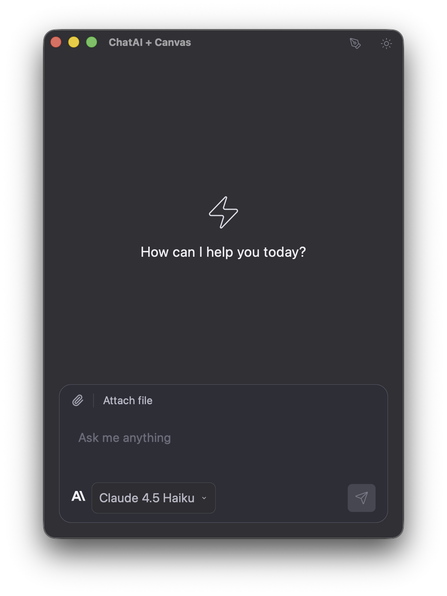

# Gooey

A GPU-accelerated UI framework for Zig. It targets macOS (Metal), Linux (Wayland with
Vulkan or a CPU renderer, or the kernel framebuffer), Windows (Win32 with Vulkan or
Direct3D 11), and the browser (WASM with WebGPU).

Join the [Gooey discord](https://discord.gg/bmzAZnZJyw)


> **0.4.0 replaces the 0.3.1 API:** `gooey.run`, `gooey.core.*`, `cx.animations`, `cx.changed`,
> `cx.accessible`, `cx.io()`, `gooey.file_dialog`, and the validation helpers are gone.
> This readme describes 0.4.0 only.

[][ci]

[ci]: https://github.com/duanebester/gooey/actions/workflows/ci.yml

Example app built with Gooey 0.2.9: [**chat-zig**](https://github.com/duanebester/chat-zig),
an Anthropic Claude client.

<a href="https://github.com/duanebester/chat-zig">
  
</a>

## Features

- **Small core.** An app is a state struct, a render function, and handlers. `gooey.App`,
  `gooey.Cx`, and `gooey.ui` cover most of it.
- **Static memory.** Each app declares a resource budget at compile time. Gooey reserves
  everything before the first frame, never grows it, and fails fast naming the pool that ran
  out.
- **Flexbox-style layout** with keyed identity, scrolling, popovers, and modals.
- **Text input with IME**, undo, selection, and clipboard through the text engines.
- **Components** (buttons, checkboxes, selects, modals, virtual lists, text inputs, a code
  editor, Lucide icons) and **charts**, built as library code on the public API.
- **Accessibility** through VoiceOver (macOS), UI Automation (Windows), and ARIA (web).
- **Zero dependencies.** No Zig packages; only system frameworks and libraries.

## Requirements

- **Zig 0.17.0** or newer (`minimum_zig_version` in `build.zig.zon`).
- **macOS:** 14.0 or newer.
- **Linux:** a Wayland compositor and Vulkan driver for the default backend, plus FreeType,
  HarfBuzz, Fontconfig, libpng, and D-Bus. See [Linux](#linux).
- **Windows:** 64-bit, with the Vulkan loader your GPU driver installs. No SDK is needed.

## Add Gooey to an application

Fetch the release into your `build.zig.zon`:

```bash
zig fetch --save git+https://github.com/duanebester/gooey#v0.5.2
```

Then import the modules in your `build.zig`. `gooey` is required; `gooey-components` and
`gooey-charts` are optional siblings from the same dependency.

```zig
const std = @import("std");

pub fn build(b: *std.Build) void {
    const target = b.standardTargetOptions(.{});
    const optimize = b.standardOptimizeOption(.{});
    const gooey_dependency = b.dependency("gooey", .{
        .target = target,
        .optimize = optimize,
    });

    const executable = b.addExecutable(.{
        .name = "my-app",
        .root_module = b.createModule(.{
            .root_source_file = b.path("src/main.zig"),
            .target = target,
            .optimize = optimize,
            .imports = &.{
                .{ .name = "gooey", .module = gooey_dependency.module("gooey") },
                .{
                    .name = "gooey-components",
                    .module = gooey_dependency.module("gooey-components"),
                },
            },
        }),
    });
    b.installArtifact(executable);
}
```

The `gooey` module carries its platform link requirements, so your build does not list
frameworks or system libraries.

## Hello world

```zig
const gooey = @import("gooey");

const State = struct { count: i32 = 0 };

pub const App = gooey.App(State, render, .{
    .title = "Counter",
    .width = 400,
    .height = 300,
    .limits = .nano,
});

pub const main = App.main;

fn render(cx: *gooey.Cx) void {
    cx.render(gooey.ui.text("Hello", .{}));
}
```

`gooey.App(State, render, config)` owns the state, initializes it in place from its field
defaults, and generates the entry point: `main` on native targets and the browser exports on
WASM. The root file must declare `pub const main = App.main;`.

## Run the examples

Every example in `src/examples/` is a complete app; read them next. Run one with
`zig build <step>`.

| Step                   | Source                     | Shows                                      |
| ---------------------- | -------------------------- | ------------------------------------------ |
| `run`                  | `todo.zig`                 | TextInput with IME, scroll box, filters    |
| `run-counter`          | `counter.zig`              | State, handlers, components                |
| `run-layout`           | `layout.zig`               | Popover layer, click outside, keymap       |
| `run-actions`          | `actions.zig`              | Keymaps, key contexts, actions             |
| `run-animation`        | `animation.zig`            | `tween`, `tweenOn`, spring `motion`        |
| `run-dynamic-counters` | `dynamic_counters.zig`     | Entities                                   |
| `run-accessible-form`  | `accessible_form.zig`      | Roles, headings, live regions, `announce`  |
| `run-nested-overlay`   | `nested_overlay.zig`       | `Select` inside a `Modal`                  |
| `run-virtual-list`     | `virtual_list_example.zig` | `List` with per-row heights                |
| `run-data-table`       | `data_table_example.zig`   | 10,000 rows, `on_init`, sorting            |
| `run-code-editor`      | `code_editor.zig`          | `CodeEditor`, folder dialog, custom limits |
| `run-images`           | `images.zig`               | `Painter.image`, fit modes, effects        |
| `run-lucide-demo`      | `lucide_demo.zig`          | `Painter.svg` with every Lucide icon       |
| `run-dashboard`        | `dashboard.zig`            | gooey-charts in `ui.paint` elements        |
| `run-core-file-dialog` | `core_file_dialog.zig`     | Open, multi-select, folder, save dialogs   |

`lucide-demo` does not build on Windows; every other example builds on every desktop
platform.

## Building blocks

The public surface is `src/root.zig`, and `src/api_check.zig` pins it. `gooey.internals` is
not API and may change in any release.

### App, Config, and ResourceLimits

`Config` has four required fields and five reviewed defaults:

| Field       | Default         | Meaning                                                    |
| ----------- | --------------- | ---------------------------------------------------------- |
| `title`     | required        | Window title.                                              |
| `width`     | required        | Initial width in logical pixels.                           |
| `height`    | required        | Initial height in logical pixels.                          |
| `limits`    | required        | The `ResourceLimits` budget. There is no default.          |
| `theme`     | `&Theme.light`  | The theme every color token resolves against.              |
| `keymap`    | `&.{}`          | Keyboard bindings for actions.                             |
| `entities`  | `&.{}`          | Entity types, one fixed pool each.                         |
| `fonts`     | `.{}`           | App and mono families, and their size.                     |
| `on_init`   | `null`          | `fn (state: *State, effects: *Effects) void`, run at init. |

Unknown fields are compile errors. Pick the smallest profile that fits. Each profile's
`text.fonts` is the `FontLimits` profile of the same name, the faces the app loads at init:

| Profile     | For                                                 | Font faces |
| ----------- | --------------------------------------------------- | ---------: |
| `.nano`     | Counter-class apps                                  |          1 |
| `.small`    | Single-screen forms and lists                       |          4 |
| `.standard` | Multi-panel apps, tables, dashboards                |          6 |
| `.large`    | Dense content, hundreds of icons, large images      |          6 |
| `.ceiling`  | Framework maxima for tests; `gooey.App` rejects it  |         14 |

To raise one budget without moving the whole app up a rung, start from a profile and change
fields. `code_editor.zig` reserves one code editor slot on top of `.small`:

```zig
pub const limits = blk: {
    var value = gooey.ResourceLimits.small;
    value.text.editor = .{ .count_max = 1, .bytes_max = file_bytes_max, .undo_depth_max = 128 };
    break :blk value;
};

pub const App = gooey.App(State, render, .{
    .title = "Code Editor",
    .width = window_width,
    .height = window_height,
    .limits = limits,
    .theme = &gooey.Theme.dark,
});
```

A modified value keeps the faces of the profile it started from; set `text.fonts` to load
others. A mixed budget passes the same compile-time checks as a profile. Layout takes its capacities
from the same budget: `build.element_count_frame_max` elements, `build.box_depth_max` levels
of box nesting (64 at every profile, the window root included), and one floating root per
`build.layer_count_frame_max` layer. The accessibility tree and the platform screen-reader
bridge hold `a11y.element_count_max` nodes (128 at `nano` to 8,192 at `large`). The fields and
their measurements are in `src/core/limits.zig` and `docs/v0.4.0-memory-budget.md`.

### Render with `Cx` and `ui`

A render function takes `*gooey.Cx` and emits elements with `cx.render`. There are four
element constructors:

- `ui.box(box, children)`: a container. `ui.Box` holds per-element fields (`key`, `style`,
  `layer`, `focusable`, `key_context`, `on_click`, `on_click_outside`, `on_key`, `actions`,
  `a11y`).
- `ui.text(content, text)`: a text run. `ui.Text` has `size`, `color`, `weight`, `italic`,
  `family`, `wrap`, `line_height`, and `alignment`.
- `ui.paint(Data, &data, paint_fn, style)`: a leaf drawn with a `Painter`.
- `ui.when(condition, render_fn)`: renders `render_fn` only when `condition` holds.

Children are elements, components, tuples, optionals, and arrays or slices of components. A
component is any struct with `pub fn render(self, cx: *Cx) void`. From `todo.zig`:

```zig
pub fn render(cx: *Cx) void {
    const s = cx.state(State);
    cx.render(ui.box(.{ .style = .{
        .width = .{ .grow = 1 },
        .height = .{ .grow = 1 },
        .padding = .all(24),
        .gap = 16,
        .background = .{ .rgba = .rgb(0.96, 0.96, 0.97) },
    } }, .{
        ui.text("Todos", .{ .size = 28, .color = .{ .rgba = .rgb(0.1, 0.1, 0.15) } }),
        ui.box(.{ .style = .{
            .direction = .row,
            .width = .{ .grow = 1 },
            .gap = 8,
            .alignment = .center_cross,
        } }, .{
            TextInput{
                .key = "new-todo",
                .placeholder = "What needs doing?",
                .bind = &s.draft,
                .width = null,
            },
            Button{ .label = "Add", .on_click = cx.on(State.addTodo, .{}) },
        }),
        FilterBar{},
        ui.when(s.count == 0, emptyHint),
        ui.when(s.count > 0, todoList),
        Footer{},
    }));
}
```

`ui.Style` holds layout and appearance only: `direction`, `width`, `height`, the `_min` and
`_max` sizes, `padding`, `gap`, `alignment`, `background`, `border`, `corner_radius`,
`shadow`, `opacity`, `clip`, `scroll`, `cursor`, `pointer_events`, and `source`. It has no
per-element data, so a style can be a shared constant:

```zig
const row_style: ui.Style = .{
    .direction = .row,
    .width = .{ .grow = 1 },
    .gap = 12,
    .alignment = .center_cross,
    .padding = .all(10),
    .background = .{ .rgba = ui.Color.white },
    .corner_radius = .all(8),
};

const TodoRow = struct {
    index: u32,

    pub fn render(self: TodoRow, cx: *Cx) void {
        const todo = &cx.state(State).todos[self.index];
        const color = if (todo.done) ui.Color.rgb(0.6, 0.6, 0.6) else ui.Color.rgb(0.1, 0.1, 0.1);
        cx.render(ui.box(.{ .key = .{ .index = self.index }, .style = row_style }, .{
            Checkbox{
                .checked = todo.done,
                .on_click = cx.on(State.toggle, .{ .arg = self.index }),
            },
            ui.text(todo.text(), .{ .size = 16, .color = .{ .rgba = color } }),
            spacer,
            Button{
                .label = "Delete",
                .variant = .danger,
                .size = .small,
                .on_click = cx.on(State.remove, .{ .arg = self.index }),
            },
        }));
    }
};
```

Sizes are `.fit` (the default), `.{ .grow = weight }`, `.{ .fixed = px }`, or
`.{ .percent = fraction }`. Colors are theme tokens (`.surface`, `.primary`, `.text`,
`.muted`, ...) or literals (`.{ .rgba = Color.rgb(...) }`). A box with `.scroll = .{}`
scrolls; give it a `key` so its offset is kept.

The `Cx` methods:

| Method                               | Use                                                      |
| ------------------------------------ | -------------------------------------------------------- |
| `cx.state(State)`                    | The root state.                                          |
| `cx.render(child)`                   | Emit an element, component, tuple, or slice.             |
| `cx.on(method, options)`             | Build a `Handler`.                                       |
| `cx.id(key)`                         | The `ElementId` a child box with `key` will get.         |
| `cx.hovered(id)`, `cx.focused(id)`   | Pointer and focus state, for choosing a style.           |
| `cx.theme()`, `cx.fontMetrics()`     | The active theme and base font metrics.                  |
| `cx.requestRenderAfter(delay_ms)`    | Render again by then; renew it every frame you need it.  |
| `cx.retain`, `cx.get`, `cx.release`  | Retained state and entity reads.                         |

Hover is not a style field. A component reads `cx.hovered(cx.id(key))` and picks a style, as
`lucide_demo.zig` does for its icon cells.

### Handlers and Effects

A handler is a method on the root state (or on an entity) with one of four shapes:

```text
fn (state: *State) void
fn (state: *State, arg: Arg) void
fn (state: *State, effects: *Effects) void
fn (state: *State, arg: Arg, effects: *Effects) void
```

`cx.on(method, options)` accepts only `.arg` and `.entity`. `.arg` is coerced to the
method's argument type and must fit in 8 bytes; pass an index for larger data. Every handler
call requests a render. From `counter.zig`, trimmed:

```zig
pub const State = struct {
    count: i32 = 0,
    step: i32 = 1,
    message: []const u8 = "",

    pub fn increment(self: *State) void {
        self.count += self.step;
    }

    pub fn setStep(self: *State, step: i32) void {
        self.step = step;
        self.message = "";
    }

    pub fn resetAndBlur(self: *State, effects: *Effects) void {
        self.count = 0;
        self.message = "Reset and blurred!";
        effects.blur();
    }
};
```

```zig
Button{ .label = "+", .size = .large, .on_click = cx.on(State.increment, .{}) },
```

```zig
.on_click = cx.on(State.setStep, .{ .arg = self.value }),
```

In Debug and ReleaseSafe builds, a handler whose state type is neither the root state nor a
registered entity panics on the first frame with the method's name, and so does `cx.state`
with the wrong type.

`Effects` is how a handler asks the framework for things. Requests apply after the handler
returns.

| Method                                   | Effect                                              |
| ---------------------------------------- | --------------------------------------------------- |
| `focus(id)`, `blur()`                    | Move or clear keyboard focus.                       |
| `quit()`                                 | Close the app.                                      |
| `requestRender()`, `stopPropagation()`   | Render again; stop the event from bubbling further. |
| `openFileDialog(request)`                | Open or save dialog; see below.                     |
| `setTheme(theme)`, `setFont(name, size)` | Switch the theme or the app font family.            |
| `announce(text, politeness)`             | Ask the screen reader to speak.                     |
| `create(T, value)`, `remove(T, handle)`  | Create or remove an entity.                         |
| `handler(method)`                        | A root-state handler for a completion.              |
| `inputEvent()`, `completionEvent()`      | What invoked this handler.                          |

**File dialogs.** A handler requests a dialog and names the handler that receives the
outcome. The dialog opens on the main thread after the handler returns, and the outcome
(`file_selected`, `cancelled`, or `failed`) arrives on the next drain. From
`core_file_dialog.zig`:

```zig
    pub fn save(_: *State, effects: *Effects) void {
        effects.openFileDialog(.{
            .kind = .{ .save = .{ .directory = null, .suggested_name = "untitled.txt" } },
            .on_complete = effects.handler(State.completed),
        });
    }

    pub fn completed(self: *State, effects: *Effects) void {
        const completion = effects.completionEvent().?;
        self.path_len = 0;
        switch (completion.outcome) {
            .file_selected => |paths| {
                const first = paths.first();
                const kept = keptLength(first);
                @memcpy(self.path_bytes[0..kept], first[0..kept]);
                @memset(self.path_bytes[kept..], 0);
                self.path_len = @intCast(kept);
                if (paths.count == 1) {
                    self.setStatus("Selected:", .{});
                } else {
                    self.setStatus("Selected {d} paths; the first:", .{paths.count});
                }
            },
            .cancelled => self.setStatus("Cancelled.", .{}),
            .failed => self.setStatus("The dialog failed.", .{}),
        }
    }
```

Open dialogs take `gooey.PathPromptOptions` (`files`, `directories`, `multiple`). A
selection's path count and bytes are bounded by `limits.events`. `Paths.iterator()` walks
every path of a multiple selection.

**Timers.** There is no timer API. A view that changes with the clock calls
`cx.requestRenderAfter(delay_ms)` in every render that needs the next one.

**Background work.** 0.4.0 has no public API for it. Handlers run on the main thread, and the
completions they receive come from file dialogs.

### Keymaps and actions

An action is an empty struct type. The keymap binds keys to it in `Config`, and a box handles
it with `actions` while it is on the focus path. From `layout.zig`:

```zig
const CloseMenu = struct {};
```

```zig
    .keymap = &.{.{ .keys = "escape", .action = ui.action(CloseMenu) }},
```

```zig
    cx.render(ui.box(.{
        .actions = &.{.{
            .action = ui.action(CloseMenu),
            .handler = cx.on(State.closeDropdown, .{}),
        }},
```

A binding with `.key_context = .named("Editor")` matches only inside a box with
`.key_context = .named("Editor")`. `actions.zig` binds Save that way. Key strings name exact
modifiers, such as `"cmd-shift-z"` or `"ctrl-s"`.

### Entities

Entities are app data with their own handlers, kept in fixed pools. List the types in
`Config.entities`; each pool holds `limits.entities.count_per_type_max` values. From
`dynamic_counters.zig`:

```zig
pub const Counter = struct {
    count: i32 = 0,
    label: []const u8 = "Counter",

    pub fn increment(self: *Counter) void {
        self.count += 1;
    }

    pub fn decrement(self: *Counter) void {
        self.count -= 1;
    }

    pub fn reset(self: *Counter) void {
        self.count = 0;
    }
};
```

```zig
    pub fn addCounter(self: *State, effects: *Effects) void {
        assert(self.counter_count <= counter_count_max);
        if (self.counter_count == counter_count_max) return;
        const label = labels[self.counter_count];
        self.counters[self.counter_count] = effects.create(Counter, .{ .label = label });
        self.counter_count += 1;
    }

    pub fn removeCounter(self: *State, effects: *Effects) void {
        assert(self.counter_count <= counter_count_max);
        if (self.counter_count == 0) return;
        self.counter_count -= 1;
        effects.remove(Counter, self.counters[self.counter_count]);
    }
```

```zig
pub const App = gooey.App(State, render, .{
    .title = "Dynamic Counters",
    .width = 600,
    .height = 400,
    .limits = .nano,
    .entities = &.{Counter},
});
```

Read an entity with `cx.get` and bind a handler to it with `.entity`:

```zig
        const data = cx.get(Counter, self.counter);
```

```zig
                    .on_click = cx.on(Counter.increment, .{ .entity = self.counter }),
```

`effects.create` claims the slot at once. `remove` frees it after the current drain, and a
stale handle panics in every build mode. Key an entity's boxes by its `slot` and
`generation` so a reused slot starts fresh.

### Retained state and text engines

`cx.retain(T, id, lifetime, init)` finds or creates state kept under a keyed `ElementId`, and
`cx.get` reads it during the tick. `gooey.Lifetime` is `.frame` (swept after a few unrendered
frames), `.{ .scope = id }` (alive while `id` renders), or `.owned` (freed only by
`cx.release`). Pointers from `cx.get` do not survive the tick.

The three text engines, `gooey.InputEngine`, `gooey.AreaEngine`, and `gooey.EditorEngine`,
are retained values with their own pools, sized by `limits.text.input`, `.area`, and
`.editor`. Every profile reserves inputs; `.nano` reserves no areas, and no profile reserves
editors. Apps normally use them through `TextInput`, `TextArea`, and `CodeEditor`, which bind
to a `[]const u8` field in state. The engines own copy, cut, and paste; the clipboard has no
public API. This is how `TextInput` retains its engine:

```zig
        const handle = cx.retain(InputEngine, id, .{ .scope = id }, initEngine);
        const engine = cx.get(InputEngine, handle);
        engine.syncBound(self.bind);
        const focused = cx.focused(id);
        setView(&engine.view, theme, id, self.placeholder);
        engine.blink(cx, focused);
```

### Animation

`gooey.animation` has three module functions. Each keeps its state under a key and requests
frames only while it moves. From `animation.zig`:

```zig
    const fade_in = animation.tween(cx, .{ .name = "main-fade" }, .{ .duration_ms = 500 });
```

```zig
        const pulse = animation.tweenOn(cx, .{ .name = "count-pulse" }, trigger, .{
            .duration_ms = 200,
            .easing = animation.Easing.easeOutBack,
        });
```

```zig
        const m = animation.motion(cx, .{ .name = "panel-spring" }, self.show, .snappy);
        assert(m.progress >= 0);
        assert(m.progress <= 1);
        if (!m.visible) return;
```

`tween` eases from 0 to 1 after its first build and replays when its element returns.
`tweenOn` starts at 1 and plays from 0 again whenever its trigger changes. `motion`
springs toward shown or hidden and reports `progress`, `visible`, and `phase`. Easings are in
`animation.Easing` (`linear`, `easeIn`, `easeOut`, `easeInOut`, `easeOutCubic`,
`easeOutBack`); spring presets are `.snappy`, `.bouncy`, `.gentle`, `.stiff`, and `.wobbly`.

### Painting

`ui.paint` draws a leaf with a `Painter`, whose `bounds` is the element's rectangle. The
painter has `fill`, `quad`, `text`, `textOnBaseline`, `measureText`, `svg`, `image`, `line`,
`circle`, `polyline`, `pointCloud`, `triangles`, `pushClip`, and `popClip`. From
`images.zig`:

```zig
                ui.paint(Item, item, paintImage, .{
                    .width = .{ .fixed = item.width },
                    .height = .{ .fixed = item.height },
                }),
```

```zig
fn paintImage(item: *const Item, painter: *ui.Painter) void {
    assert(item.width > 0);
    assert(item.height > 0);
    painter.image(logo_path, painter.bounds, item.style);
}
```

`ui.PaintImage` sets `fit`, `corners`, `tint`, `grayscale`, and `opacity`. Images decode on a
worker and appear a few frames later. `painter.svg(path, bounds, .{ .fill, .stroke,
.stroke_width })` draws SVG path data such as `components.Lucide` icons. The `data` pointer
must stay valid until the frame is emitted, so point it at state or a constant.

## Components

`gooey-components` is library code on the public API; only `List` reaches into
`gooey.internals`, for its scroll state. Import it as `@import("gooey-components")`.

| Component       | Notes                                                                       |
| --------------- | --------------------------------------------------------------------------- |
| `Button`        | `label`, `on_click`, `variant`, `size` (`.small`, `.medium`, `.large`)      |
| `Checkbox`      | `checked`, `on_click`, optional `label`                                     |
| `Select`        | Dropdown on a popover layer; the app owns `selected` and `open`             |
| `Modal(Child)`  | Dialog over a backdrop on a modal layer                                     |
| `List(Row)`     | Virtual list that builds only visible rows                                  |
| `TextInput`     | Single-line input bound to a `[]const u8`                                   |
| `TextArea`      | Multi-line input; needs `limits.text.area`                                  |
| `CodeEditor`    | Line numbers, status bar, Tab indent; needs `limits.text.editor`            |
| `Lucide`        | SVG data for every Lucide icon, for `Painter.svg`                           |

`Select` takes one handler per option. From `nested_overlay.zig`:

```zig
        var on_select: [options.len]Handler = undefined;
        for (&on_select, 0..) |*handler, index| {
            handler.* = cx.on(State.selectOption, .{ .arg = @as(u32, @intCast(index)) });
        }
```

```zig
            Select{
                .key = "nested-select",
                .options = &options,
                .on_select = &on_select,
                .on_toggle = cx.on(State.toggleSelect, .{}),
                .on_close = cx.on(State.closeSelect, .{}),
                .selected = state.selected,
                .open = state.select_open,
                .width = 280,
            },
```

A `List` row has an `index: u32` field and declares either one height for every row
(`pub const row_height`) or a height per row (`pub fn height(cx, index)` with
`pub const count_max`). From `virtual_list_example.zig`:

```zig
        List(MessageRow){
            .key = "chat-list",
            .count = message_count,
            .gap = 8,
            .style = .{ .background = .surface, .corner_radius = .all(8), .padding = .all(8) },
        },
```

```zig
pub const MessageRow = struct {
    index: u32,

    pub const count_max: u32 = message_count;

    pub fn height(_: *Cx, index: u32) f32 {
        assert(index < message_count);
        return messages[index].height();
    }
```

The row's `render` follows in the file.

`gooey-charts` draws bar, line, pie, and scatter charts through a `Painter`. Keep series in
state and fill them in `on_init`. See [charts/README.md](charts/README.md) and
`dashboard.zig`.

## Theming and fonts

`gooey.Theme.light` (Catppuccin Latte) is the default and `gooey.Theme.dark` (Catppuccin
Macchiato) is built in. Set one in `Config` with `.theme = &gooey.Theme.dark`, or switch at
run time from a handler, as the theme check in `src/testing/goldens/core_checks.zig` does:

```zig
    pub fn goDark(_: *ThemeState, effects: *Effects) void {
        effects.setTheme(&gooey.Theme.dark);
        effects.announce("Dark theme", .polite);
    }
```

A custom theme is a `gooey.Theme` value with every color field set: `bg`, `surface`,
`overlay`, `primary`, `secondary`, `accent`, `success`, `warning`, `danger`, `text`,
`subtext`, `muted`, `border`, and `border_focus`. `radius_sm`, `radius_md`, `radius_lg`, and
`font_size_base` have defaults. Color tokens of the same names resolve against the active
theme, and components scale their text from `font_size_base`.

`Config.fonts` sets the app family (`name`, null for the platform's sans-serif), the point
size (`size`, null for `font_size_base`), and an optional second family (`mono`). The faces
each family loads are part of the budget, `limits.text.fonts`, so a second family needs mono
faces there:

```zig
    .limits = font_limits,
    .fonts = .{ .mono = .{ .system = .monospace } },
});

const font_limits = blk: {
    var value = gooey.ResourceLimits.nano;
    value.text.fonts = .{ .variants = &.{.regular}, .mono_variants = &.{.regular} };
    break :blk value;
};
```

```zig
        ui.text("mmm", .{ .size = 16, .family = .mono }),
```

`effects.setFont(name, size)` swaps the app family at run time into the same face slots.
The font snippets also come from `core_checks.zig`.

## Accessibility

Accessibility is a field on the box. `ui.A11y` has `role` (`gooey.accessibility.Role`),
`label`, `value`, `checked`, `disabled`, `heading_level`, `live`, `href`, `description`,
`expanded`, `has_popup`, `pos_in_set`, and `set_size`. The components fill it in. From
`accessible_form.zig`:

```zig
        cx.render(ui.box(.{
            .a11y = .{ .role = .heading, .label = self.text, .heading_level = self.level },
        }, .{
```

```zig
            .a11y = .{ .role = .alert, .label = self.message, .live = .assertive },
```

```zig
            effects.announce("Form submitted successfully!", .polite);
        } else {
            effects.announce("Please fix the errors in the form", .assertive);
```

Screen readers: VoiceOver on macOS, UI Automation (Narrator, NVDA) on Windows, and ARIA in
the browser. Linux has no screen reader support in 0.4.0. See
[docs/accessibility.md](docs/accessibility.md) for roles, live regions, limits, and testing.

## Debugging and logging

Debug and ReleaseSafe builds include an inspector and profiler, toggled with
Cmd/Ctrl+Shift+I. Set `.source = @src()` on a `Style` to show where an element was built.
ReleaseFast and ReleaseSmall compile both out.

`gooey.log` works on native and WASM without configuration:

```zig
const log = gooey.log.scoped(.myapp);
log.info("connected to {s}", .{host});
```

To route `std.log` (and libraries that use it) to the browser console too, declare this in
the root file:

```zig
pub const std_options = gooey.std_options;
```

## Not in 0.4.0

- **Known gaps:** the web host has no file dialogs and does not load images yet. The IME
  candidate window is placed at the caret, whatever character range the input method asks
  about. Linux has no screen reader bridge.
- **Cut from 0.4.0:** multi-window (one window per app), liquid glass, custom shaders, and
  post-processing.
- **Deferred:** drag and drop, tooltip layers, and programmatic scrolling (`List` has no
  `scroll_to`).

## Platforms

### macOS

Metal rendering, CoreText text, native file dialogs, IME, and VoiceOver. Requires macOS 14.
`zig build hot` rebuilds and restarts on source changes (macOS only):

```bash
zig build hot                    # todo
zig build hot -- run-counter     # any run step
```

### Linux

Wayland only, with no X11 fallback. Text uses FreeType, HarfBuzz, and Fontconfig, file
dialogs use the XDG Desktop Portal over D-Bus, and IME uses `zwp_text_input_v3`. Windows
render at fractional scales through `wp_fractional_scale_v1`, and hover cursors use
`wp_cursor_shape_v1` or, without it, the XCursor theme (`XCURSOR_THEME`, `XCURSOR_SIZE`).

```bash
# Debian/Ubuntu
sudo apt install libwayland-dev libvulkan-dev libfreetype-dev libharfbuzz-dev \
    libfontconfig-dev libpng-dev libdbus-1-dev

# Fedora/RHEL
sudo dnf install wayland-devel vulkan-loader-devel freetype-devel harfbuzz-devel \
    fontconfig-devel libpng-devel dbus-devel

# Arch Linux
sudo pacman -S wayland vulkan-icd-loader freetype2 harfbuzz fontconfig libpng dbus
```

`-Dlinux-backend` selects the display and renderer at build time:

| Backend                    | Display            | Renderer             | Display libraries |
| -------------------------- | ------------------ | -------------------- | ----------------- |
| `wayland_vulkan` (default) | Wayland compositor | Vulkan               | Vulkan, Wayland   |
| `wayland_cpu`              | Wayland compositor | CPU into `wl_shm`    | Wayland           |
| `fbdev`                    | `/dev/fb0`         | CPU into framebuffer | None              |

```bash
zig build run -Dlinux-backend=wayland_cpu                 # no GPU driver
zig build run -Dlinux-backend=fbdev -Doptimize=ReleaseSafe  # kernel framebuffer
zig build compile-shaders   # only after editing GLSL; needs glslc
```

Precompiled SPIR-V is checked in; pass `-Dskip-shader-compile=true` when `glslc` is missing.
The fbdev backend still links FreeType, HarfBuzz, Fontconfig, libpng, and D-Bus. It covers the
whole panel, reads 16 and 32 bpp framebuffers, takes input from `/dev/input/event*`, and
completes file dialog requests with `error.FileDialogUnsupported`. Ctrl+Q or Alt+F4 exits.

| Variable             | Effect                                                     |
| -------------------- | ---------------------------------------------------------- |
| `GOOEY_FBDEV`        | Framebuffer device path (default `/dev/fb0`)               |
| `GOOEY_SCALE`        | UI scale factor from 1 to 8 (default 1)                    |
| `GOOEY_EVDEV_GRAB=1` | Grab input devices exclusively so the console ignores them |

The CPU renderer reserves its framebuffers from `limits.window` (`framebuffer_width_max`
and `framebuffer_height_max`). An fbdev panel larger than that fails to open, and a larger
Wayland window renders at a reduced scale.

### Windows

Win32 windows, the shared Vulkan renderer or Direct3D 11 (`-Dwindows-renderer=dx11`, which
falls back to WARP without a hardware driver), DirectWrite text, WIC images, native file
dialogs, IME, and UI Automation. 64-bit only. See [docs/windows-port.md](docs/windows-port.md).

```bash
zig build run-todo
zig build run-todo -Dwindows-renderer=dx11
zig build test-windows
```

### Web (WASM)

```bash
zig build wasm                 # todo, into zig-out/web
zig build wasm-counter         # counter, into zig-out/web/counter
python3 -m http.server 8080 -d zig-out/web
```

The browser needs WebGPU. The page runs every frame stage on the browser's one thread. Gooey
avoids `std.Io.Threaded` on `wasm32-freestanding`; browser services use the JavaScript
bridges in `src/platform/web/`.

## Testing and CI

```bash
zig build test                  # unit tests, goldens, fail-fast checks, import ban
zig build test-valgrind         # Linux: tests under valgrind with valgrind.supp
zig build typecheck-linux       # analyze the Linux backend from any host
zig build typecheck-windows     # analyze the Windows backend from any host
zig build typecheck-macos       # analyze the macOS backend from any host
zig build goldens               # rewrite src/testing/goldens after an intended change
zig fmt --check src/ charts/
```

On Linux without `glslc`, add `-Dskip-shader-compile=true`. CI (`.github/workflows/ci.yml`)
runs tests on Linux and macOS, builds every optimize mode on both, builds the WASM targets,
runs valgrind and `zig fmt`, and gates benchmarks on macOS.

## Inspiration

- [GPUI](https://github.com/zed-industries/zed/tree/main/crates/gpui) - Zed's GPU UI framework
- [Clay](https://github.com/nicbarker/clay) - Immediate mode layout
- [Ghostty](https://github.com/ghostty-org/ghostty) - Zig + Metal terminal
